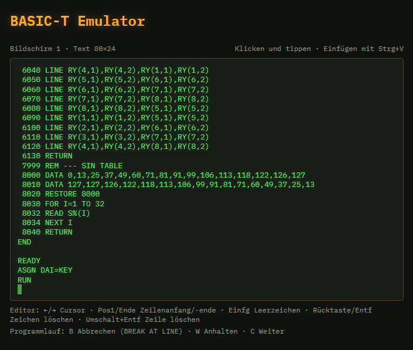
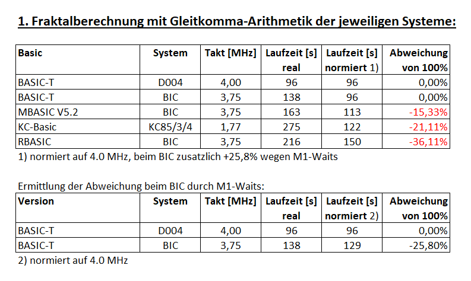
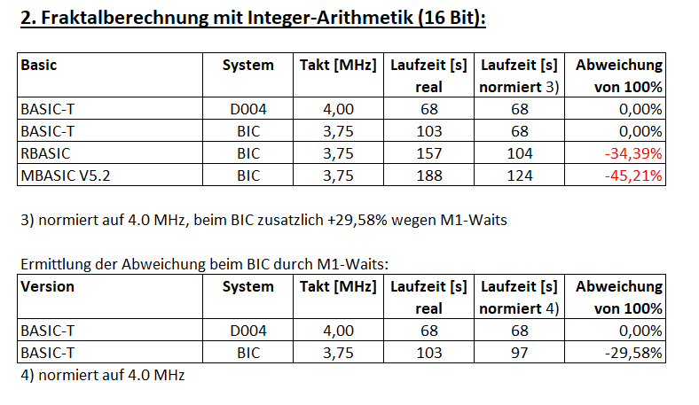

# BASIC-T – Rekonstruktion eines "BASIC-Compreters für U880 (Z80)"

[](https://basict.peppermint.de/emulator)

## Historischer Hintergrund

Ausgangspunkt für dieses Projekt war ein Zufallsfund in einer DDR-Zeitschrift. Rainer Heyne stellte das System 1984 in *radio fernsehen elektronik* (Heft 3, S. 150–152) als [„Basic-Compreter für U 880“](docs/rfe_1984_3_S.150-152.pdf) vor (*VEB Transformatoren- und Röntgenwerk „Hermann Matern“ Dresden*). Die Original-Quellprogramme zu dem System sind bis heute nicht aufgetaucht. 

Durch Recherche im [Robotrontechnik-Forum](https://www.robotrontechnik.de/html/forum/thwb/index.php) (s. [Danksagung](#danksagung)) konnte eine lauffähige COM-Datei für SCP (CP/M) aufgefunden werden, die jedoch zunächst nur das enthaltene "LOTTO-Programm" startete. Das lauffähige Programm war ohne BASIC-Quelltext in der Datei gespeichert, was nur durch die Übersetzung des Programms durch den Compreter in einen Zwischencode möglich war. Das ist gleichzeitig auch der Grund für eine schnellere Abarbeitung der Programme im Vergleich zu einem reinen BASIC-Interpreter. 

Später fand sich noch die originale [Sprachbeschreibung](docs/BASIC-T_Sprachbeschreibung.txt) an. Durch Analyse der Binärdatei mit Hilfe von KI-Werkzeugen, konnte der [Quelltext](src) restauriert werden. Zusätzlich wurde ein [Emulator](https://basict.peppermint.de/emulator) erstellt, um diese interessante historische Software testen zu können.  

<ins>Eigenschaften der Software:</ins>

- **Compreter**: Jede Zeile wird beim Eingeben geprüft und in Zwischencode
  übersetzt; fehlerhafte Zeilen werden abgewiesen. Der Quelltext wird für
  LIST parallel gespeichert (`NOMEM`/`MEM`).
  
- 12 KByte Programm (ROM-fähig), mindestens 256 Byte Arbeitszellen, für jeden
  U-880-Rechner gedacht; Gleitkomma mit 9 Dezimalstellen, Exponent bis 38,
  zusätzlich 2-Byte-Festkomma.
  
- Erweiterungen: Zeichenketten, Felder, symbolische Sprungmarken aus bis zu
  zwei Buchstaben, `IF … THEN … ELSE` mit Anweisungsfolgen, PEEK/POKE,
  CALL, Dateibefehle OPEN/CLOSE/GET/PUT.
  
- Daten in Listenform mit dynamischer Speicherverwaltung; Syntax und Lexik
  als Graphen beschrieben (Diplomarbeit Heyne, TH Dresden 1983).
  
- Allgemeine E/A-Schnittstelle mit Gerätesteuerblöcken.
  
- Ausgeliefert wurde das System als Quellprogramm mit Sprachbeschreibung.

Die [Sprachbeschreibung](docs/BASIC-T_Sprachbeschreibung.txt) von 1983 und die COM-Datei von 1986 weichen in einem Punkt von einander ab. Die Version von 1986 enthält zusätzlich Grafik-Befehle. Durch Analyse der Implementierung konnte auf die [Grafikhardware](docs/grafik-bericht.md) geschlossen werden. Die aufgefundenen Version als COM-File von 19986 ist also eine spezifische Anpassung von BASIC-T an eine weitgehend unbekannte Hardware.

## Weitere historische Bezüge

Interessant ist auch, dass der Zeitpunkt der Entstehung dieser Software (um 1983), in die rasante Entwicklung des Home-Computer-Marktes fällt. Die DDR hatte zu dieser Zeit noch keinen Heimcomputer auf dem Markt, die Pläne zur Entwicklung von solchen Geräten waren jedoch schon sehr konkret, so dass in diese Zeit auch die Auswahl eines BASIC-Interpreters für die Kleincomputer Z9001 und HC-900 fällt. Historische Überlieferungen in [[1]](https://hc-ddr.hucki.net/wiki/doku.php/z9001/basic) berichten davon, dass in diesem Auswahlverfahren am Ende noch dieses BASIC-T und ein BASIC des Instituts in Dummerstorf, was eine Mischung aus dem Sinclair-Basic und einer einfachen Version des Microsoft-Basic war, zur Auswahl standen. Man entscheid sich für das BASIC aus Dummerstorf. 

Die Compreter-Technik war in den Home-Computern der damaligen Zeit eher nicht üblich. Das Locomotive-Basic [[2]](https://8bit-museum.de/heimcomputer/amstrad/), welches im Schneider-CPC verwendet wurde, arbeitet jedoch sehr ähnlich. 

- Die Organisation aller vom Programm
benutzten Daten erfolgt in einer listenform. Durch den Einsatz der Listentechnik kann die gesamte Arbeit mit den unterschiedlichsten Daten standardisiert
und durch eine geringe Anzahl von
Standardunterprogrammen realisiert
werden.

- Auf die Listentechnik aufbauend, wird
die Verwaltung des Anwenderspeichers
dynamisch vorgenommen. Damit wird es
möglich, variabel lange Zeichenketten
zu benutzen, die Grenzen von Feldern
während des Programmlaufes zu verändern und eine beliebige Schachtelungstiefe von Unterprogrammen und For-Next-Zyklen zu erreichen.

- Die lexikalischen und syntaktischen
Analysen erfolgen durch die Abarbeitung von lexikalischen bzw. Syntaxgraphen. Die Anwendung der Graphen-
theorie im Compilerbau führt zu einer
sehr übersichtlichen Beschreibung der
Syntax im Programmspeicher des Rechners und zu einer ausgezeichneten Änderungsfreundlichkeit.

Locomotive-Basic und BASIC-T sind aber vollkommen unabhängig von einander entstanden. Mit BASIC-T stand damals ein sehr fortschrittliches und schnelles BASIC zur Verfügung. Die offenen Schnittstellen und der Vertieb in Quelltext-Form bot die Möglichkeit, BASIC-T an jedes Zielsystem anzupassen. Es fand aber trotz dieser Vorteile, offensichlich keine sehr große Verbreitung. 

## Geschwindigkeitsvergleich

Eine Fraktalberechnung mit Gleitkomma- und Integerzahlendarstellung diente hier zum Vergleich der Geschwindigkeit mit anderen BASIC-Varinanten. Eine genauere Untersuchung, in unterschiedlichen Anwendungen, wurde noch nicht durchgeführt.





## Aufbau des Compreters im Original-COM-File (Kurzfassung)

- **0100H–36FFH:** tabellengesteuerte Grammatik (`SYN_MATCH`, `RULETAB`). Sie übersetzt
  jede Zeile in Zwischencode, den die Laufzeit über `OPTAB` (1271H) ausführt.
- **3700H:** patchbare Treibertabelle (`DRVTAB`). Der Haken 3703H ist nur ein `RET`.
- **3B00H–3E27H:** Grafikmodul.
- **4000H–43ADH:** Arbeitsspeicher. Er steht am Ende des Quelltexts als Labels mit `DS`
  ab `RAM_BASE` (z. B. `ED_BUF`, `FAC`, `ARG`, `STACK_TOP`); Zellen, deren Zweck noch
  nicht sicher ist, heißen `V_xxxx`. Darüber liegt der BASIC-Programmspeicher.

Die Syntaxknoten stehen als `DB` im Quelltext. Ihr Kommentar zeigt, was sie bedeuten:
Schlüsselwort, Aktion und Folgeknoten.

## Source-Filestruktur nach Analyse und Rekonstruktion

| Datei | Inhalt | 
|---|---|
| `src/basict.asm` | Kopf, `CODE_ORG`/`RAM_BASE`, Includes | 
| `src/core_syntax.inc` | Start, Hauptschleife, Syntaxmaschine, Grammatik | 
| `src/core_run.inc` | OPTAB, Laufzeit, Befehle, Zwischencode | 
| `src/core_fp.inc` | Gleitkomma | 
| `src/core_lines.inc` | Zeilen, Fehler, Meldungen |
| `src/core_io.inc` | logische Kanalblock-E/A (`CH_OUT`, `CH_IN`, `DRV_CALL`) | 
| `src/io_cpm.inc` | BDOS-Anschluss Konsole/Drucker (`CONIN`, `CONOUT`), `DRVTAB`, `KBD_GET` | 
| `src/core_edit.inc` | Zeileneditor `ED_LINE`, braucht nur `CONIN`/`CONOUT` und Backspace 08H | 
| `src/io_cpmfile.inc` | Datei-E/A über FCB/DMA |
| `src/gfx_tur.inc` | Grafik für die TuR-Hardware (Port 08H, 9000H) | 
| `src/ram.inc` | Arbeitsspeicher (DS-Labels) | 

Damit kann der Compreter an andere System angepasst werden, siehe
  [`docs/portierung.md`](docs/portierung.md)

## Ermittelte Grafik-Hardware

- 256 × 128 Punkte, 1 Bit pro Punkt. Bildspeicher 9000H–9FFFH, 32 Byte pro Zeile,
  Ursprung unten links. Adresse = 9000H + (127 − y) · 32 + x / 8, Bitmaske 80H >> (x AND 7).
- Der Video-RAM wird über **Port 08H** eingeblendet (Bit 7 = 0) und wieder ausgeblendet
  (Bit 7 = 1), jeweils mit gesperrten Interrupts.
- Es gibt keinen Grafik-Controller: Die CPU schreibt direkt in den Speicher.
  LINE/CLINE arbeiten mit einem Festkomma-Verfahren (DDA in 8.8), nicht mit Bresenham.
- Details in [`docs/grafik-bericht.md`](docs/grafik-bericht.md).


Ebenso gibt es eine tiefergehende Analyse der Gleitkomma-Implementierung.

## Gleitkomma-Rechnung

- Fünf Byte: 31-Bit-Betragsmantisse, separates Vorzeichen und signed
  8-Bit-Binärexponent ohne Bias; kein IEEE-754.
- Grundrechenarten mit binären Schiebe-/Addier-/Divisionsverfahren; verlorene
  Bits werden abgeschnitten. Integerwandlung und Dezimalausgabe runden separat.
- SQR verwendet vier Newton-Schritte; LOG/EXP/SIN/COS/ATN arbeiten mit
  Argumentreduktion und Polynom- bzw. rationalen Näherungen.
- Originalcode unverändert; Randfälle wie `0/0` im FP-Kern und die
  Ganzzahlwandlung bei −32768 sind dokumentiert und direkt im Emulator geprüft.
- Herleitung, Adressen und Prüfergebnisse:
  [`docs/gleitkomma-bericht.md`](docs/gleitkomma-bericht.md).

## Schnellstart
 
```sh
$ cd basic-t
$ make check
IDENTISCH mit dem Original (0100H-3FFFH)
```
Voraussetzungen: `asl` und `p2bin` (Paket *asl*, z. B. `nix profile install nixpkgs#asl`,
oder aus dem Quelltext bauen) sowie GNU make.

## Verzeichnisse

| Pfad | Inhalt |
|---|---|
| `src/basict.asm` | Hauptdatei (AS, `CPU Z80UNDOC`): Kopf, Adressen, Includes |
| `src/core_*.inc` | systemunabhängiger Kern: Syntax, Laufzeit, Gleitkomma, Zeilen/Fehler |
| `src/core_io.inc` | logische Ein-/Ausgabe über Kanalblöcke (systemunabhängig) |
| `src/core_edit.inc` | Zeileneditor, nutzt nur `CONIN`/`CONOUT` (systemunabhängig) |
| `src/io_cpm.inc` | CP/M-Treiber Konsole/Drucker, Gerätetabelle `DRVTAB` (bei Portierung anpassen) |
| `src/io_cpmfile.inc` | CP/M-Datei-E/A: FCB, LOAD/SAVE/OPEN/CLOSE (bei Portierung anpassen) |
| `src/gfx_tur.inc` | Grafikmodul für die TuR-Grafikhardware |
| `src/ram.inc` | Arbeitsspeicher als DS-Labels |
| `docs/portierung.md` | E/A-Schnittstelle und Anpassung an andere Systeme (nach RFE 3/1984) |
| `original/BASICT.COM` | Original-Programmdatei (1986) |
| `original/BASICT.sha256` | Prüfsumme des Originals |
| `docs/BASIC-T_Sprachbeschreibung.txt` | Sprachbeschreibung von 1983 |
| `docs/grafik-bericht.md` | Analyse der Grafikbefehle und Rückschlüsse auf die Grafik-Hardware |
| `docs/gleitkomma-bericht.md` | Zahlenformat, Rechenverfahren, Funktionen und verifizierte Sonderfälle |
| `tools/` | Python-Skripte, die den Quelltext aus dem Original erzeugen |
| `Makefile` | Assemblieren und Vergleich mit dem Original |

## Bauen und Prüfen

```sh
make check      # assembliert nach build/BASICT.COM und vergleicht mit original/
```

Den Quelltext aus dem Original neu erzeugen (Python 3, `pip install -r tools/requirements.txt`):

```sh
sh tools/regen.sh
```

### An einer anderen Adresse assemblieren

Alle Adressen im Programm (Sprünge, Tabellen, Zeiger auf Texte und
Grammatik) stehen als Namen im Quelltext. Deshalb lässt sich BASIC-T an
einer anderen Ladeadresse übersetzen:

```sh
make reloc                       # build/BASICT-0200H-4000H.COM, Code ab 0200H
make reloc RELOC=0180H           # beliebige andere Adresse
make reloc RELOC=0100H RAM=5000H # Arbeitsspeicher ab 5000H
```

`RAM` setzt `RAM_BASE`, den Beginn des Arbeitsspeichers. Weil viele
Routinen nur das untere Adressbyte setzen (z. B. `LD L,0E2H`), rundet
`ALIGN 100H` im Quelltext ihn auf die nächste 256-Byte-Grenze (xx00H)
auf; der Arbeitsspeicher beginnt dann bei der Marke `RAM_START`. Werte mit
Buchstaben vorn mit 0 schreiben (`RAM=0A000H`). Der Bereich 8000H–9FFFH
ist ungeeignet, dort wird bei Grafik der Bildspeicher eingeblendet.
Mit RAM ab 5000H, 0A000H (Code 0100H) und 6000H (Code 0200H) liefert
BASIC-T im Emulator denselben Bildschirm und dieselbe Grafik wie das
Original.

Bei 0100H steht dann nur ein Sprung nach `START`, die Füllbytes hinter
dem Programm entfallen. Der Arbeitsspeicher beginnt bei `RAM_BASE`
(Standard 4000H), darum muss der Code unter `RAM_BASE` enden
(bei 4000H Startadresse höchstens etwa 02D8H); sonst bricht AS mit einer
Fehlermeldung ab. Eine an 0200H und an 0180H übersetzte Fassung lief im
Emulator Befehl für Befehl genauso ab wie das Original (rund 5,7
Millionen Befehle: Rechnen, Unterprogramme, LIST, Laden von Diskette,
Grafik).

Optionale Rechentests (nur Python, nicht zum Assemblieren erforderlich):

```sh
python3 -m pip install -r tools/requirements-test.txt
python3 -m unittest discover -s tools -p test_fp.py
```

## Rechte und Lizenz

Die Originaldatei und die Sprachbeschreibung sind historische Dokumente des
VEB TuR Dresden und werden hier zu Dokumentationszwecken bereitgestellt.

## Danksagung

Besonderer Dank geht an Rüdiger Kurth vom Robotrontechnik-Forum für das Bereitstellen der COM-Datei mit dem Binärcode des Basic-Compreters und der Sprachbeschreibung, sowie an alle, die sich beteiligt haben bei der Erforschung dieser Software. 

## Quellen

[1] https://hc-ddr.hucki.net/wiki/doku.php/z9001/basic

[2] https://8bit-museum.de/heimcomputer/amstrad/

[3] [Basic-Compreter für U 880](docs/rfe_1984_3_S.150-152.pdf)

[4] [BASIC-T Sprachbeschreibung](docs/BASIC-T_Sprachbeschreibung.txt)


